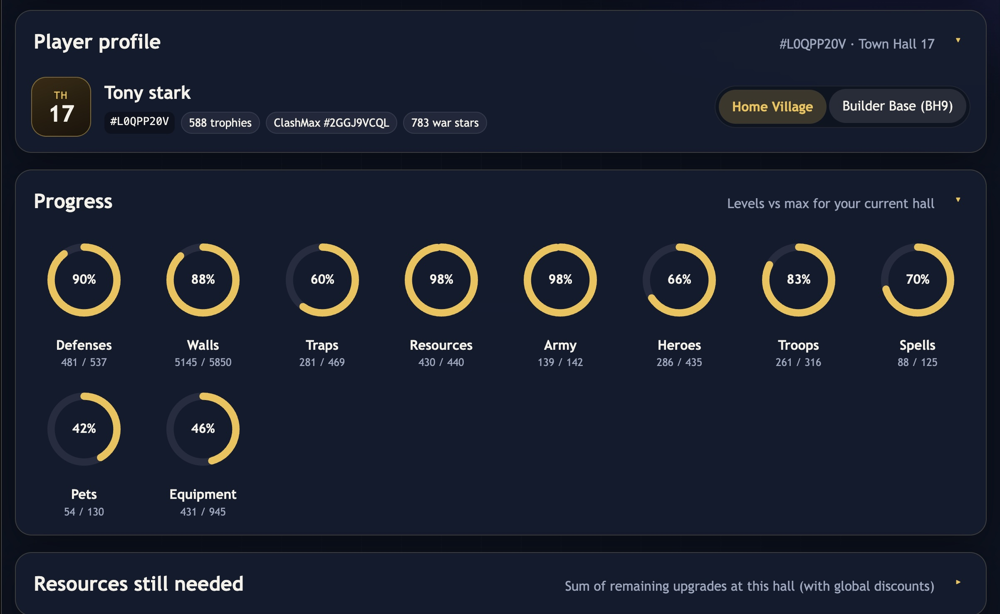
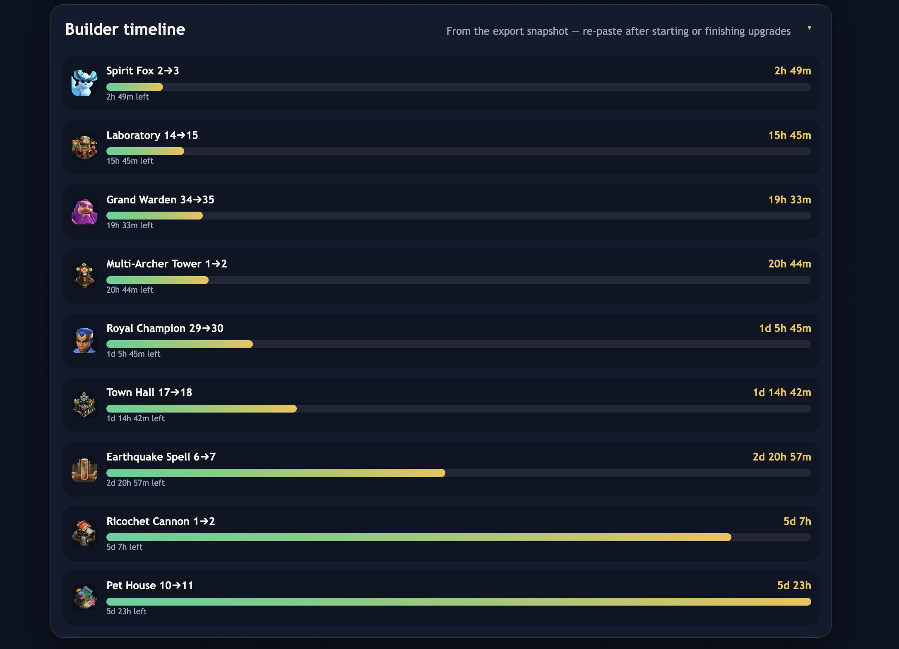
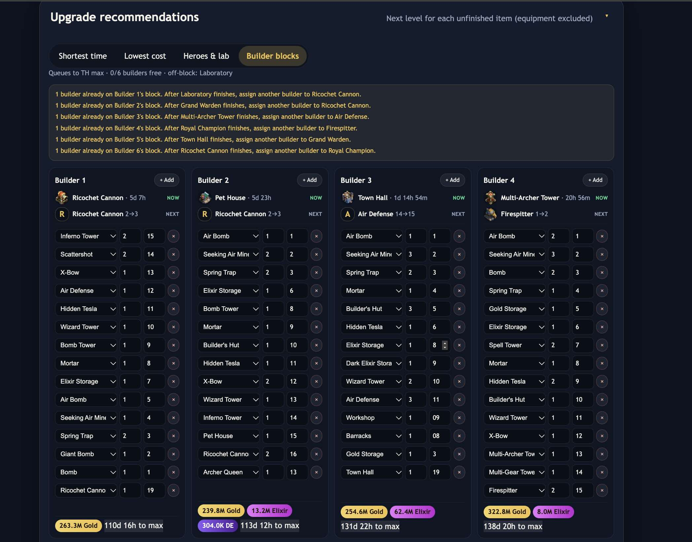
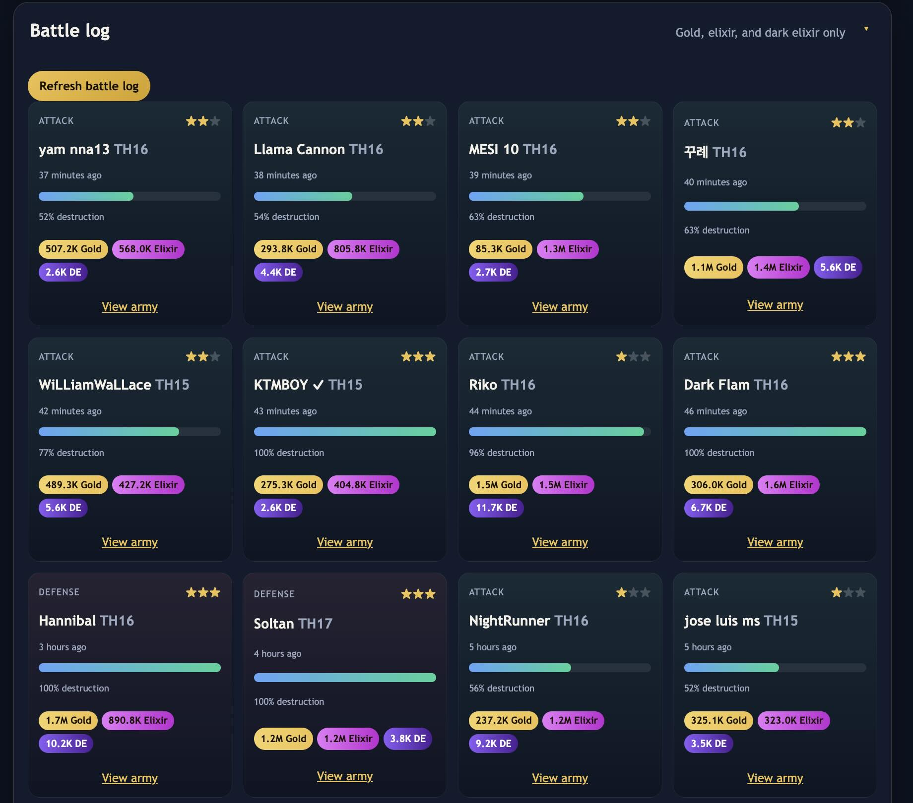
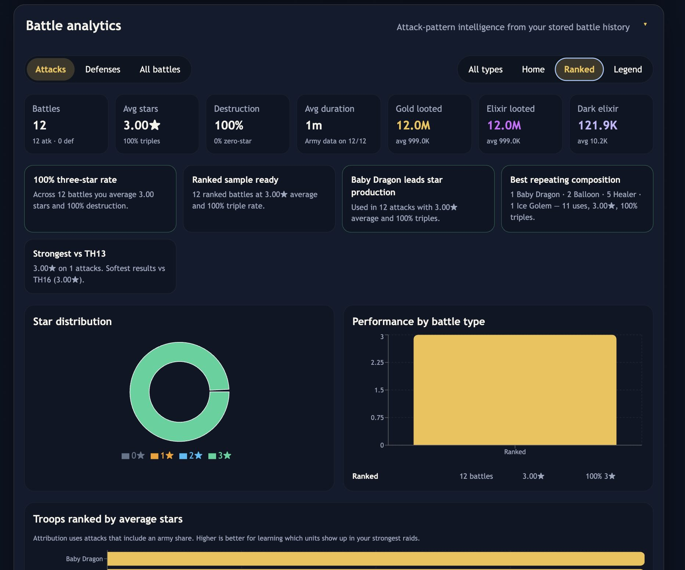

# Clash Village Tracker

Personal Clash of Clans dashboard: paste your village export, sync the official API, and plan upgrades.

<p align="center">
  
</p>

## Features

- **Village export** — building levels, builder timers, progress rings
- **Upgrade recommendations** — sort by time, cost, or heroes & lab
- **Builder blocks** — six manual queues with path-to-max cost/time and live matching
- **Heroes** — tap a hero for cost/time to TH max
- **Global discounts** — cost & builder-time % for events/passes
- **Battle log & analytics** — loot, armies, attack patterns
- **Official API** — player profile + battle history (local proxy)

<p align="center">
  
  
  
  
</p>


## Requirements

- Python 3.10+
- Node.js 18+
- Clash of Clans [developer API key](https://developer.clashofclans.com/) (allowlist your public IP)

## Install

```bash
git clone <your-repo-url>
cd coc

# API key
echo 'API_KEY=your_token_here' > .env

# Web deps
cd web && npm install && cd ..
```

Optional — refresh upgrade costs after a game update:

```bash
python3 scripts/sync_game_data.py
```

## Run

```bash
# Terminal 1 — API proxy
python3 server.py

# Terminal 2 — dashboard
cd web && npm run dev
```

Open **http://127.0.0.1:5173**.

## Usage

1. In-game: **Settings → More Settings → Data Export → Copy**
2. Paste into the dashboard
3. (Optional) enter current storages so “affordable” badges work
4. Re-paste after starting/finishing upgrades so timers stay accurate

## Notes

The official API does not expose storages or builder queues — the export fills those gaps. Icons via [ClashKing Assets](https://assets.clashk.ing); costs from [clash-of-clans-data](https://www.npmjs.com/package/clash-of-clans-data).
